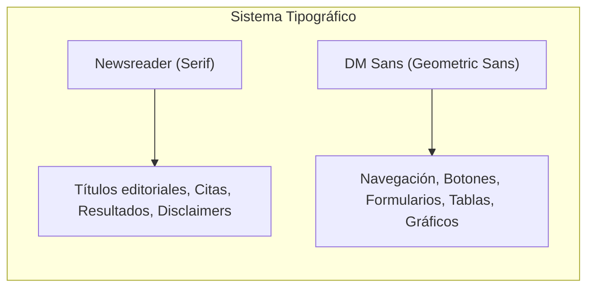
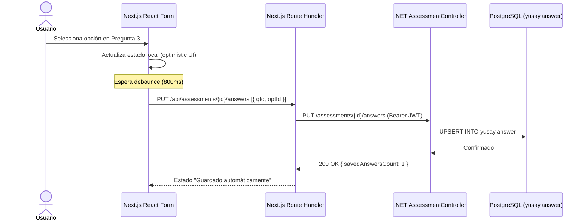
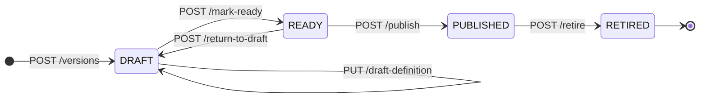
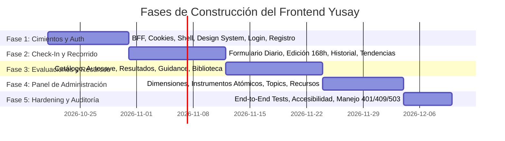

# Arquitectura Frontend Yusay v1.0 — Next.js App Router + TypeScript

> **Documento:** `docs/frontend/architecture-v1.md`  
> **Fecha:** 2026-10-20  
> **Estado:** Propuesta Técnica de Arquitectura v1.0  
> **Destino:** Plataforma de bienestar personal Yusay (No clínica)  
> **Stack:** Next.js 15+ (App Router), React 19, TypeScript 5, Tailwind CSS, TanStack Query / Server Actions, Zod, Lucide Icons, Recharts.

---

## 1. Contexto, Hallazgos y Diagnóstico de Contratos Backend

### 1.1. Contexto Operativo y Tecnológico
Yusay es una plataforma de seguimiento del bienestar subjetivo (no clínica ni diagnóstica). El backend está construido en .NET 10, PostgreSQL 18, Dapper, Redis (denylist) y migraciones Flyway.

El frontend se desplegará como una aplicación **Next.js con App Router actuando como Backend-for-Frontend (BFF) exclusivo**. El navegador del usuario jamás interactúa directamente con la API .NET:
1. **Ausencia de CORS en Backend:** La API .NET en `src/Yusay.Api/Program.cs` no habilita políticas CORS (`AddCors`/`UseCors`). Toda comunicación externa directa desde el navegador sería bloqueada por el navegador. El BFF en Node.js resuelve esta restricción ejecutando llamadas *server-to-server*.
2. **Seguridad y Privacidad de Sesión:** El token de acceso JWT se confina en una cookie `HttpOnly`, `Secure` y `SameSite=Lax/Strict`. El código JavaScript del cliente no tiene acceso al token, mitigando ataques de Cross-Site Scripting (XSS).
3. **Ciclo de Sesión:** El token JWT tiene una vida útil de **60 minutos sin mecanismo de refresh token ni renovación automática de sesión**.
4. **Mínima Recolección de Datos (Zero-PII):** El backend no almacena nombres, apellidos, avatares ni fechas de nacimiento. La identidad se reduce estrictamente a correo electrónico, confirmación de mayoría de edad y credenciales Argon2id.

---

### 1.2. Auditoría de Contratos Backend y Discrepancias Técnicas

Durante la auditoría del código C#, DTOs y migraciones SQL se identificaron las siguientes discrepancias y particularidades de contrato que el frontend debe arbitrar formalmente:

| Módulo / Recurso | Definición Backend (Código C# y BD) | Expectativa Frontend / Contrato API | Arbitraje en Frontend (BFF) |
| :--- | :--- | :--- | :--- |
| **Sesión / JWT** | Expiración fija a 60 min (`JWT_ACCESS_TOKEN_TTL_SECONDS = 3600`). Redis almacena denylist de revocación (`jti`). | Sesiones fluidas sin expulsión abrupta del usuario. | El BFF interceptará `401 Unauthorized` y gestionará reautenticación limpia. No se inventará refresh token en cliente. |
| **Check-In Update** | `PUT /check-ins/{id}` requiere `{ revision, measurements, note }`. Falla con `409 Conflict` si la revisión en BD cambió o pasaron 168h. | Edición concurrente segura y feedback claro. | El formulario de edición debe enviar siempre el entero `revision` original recibido en la carga. Si responde 409, mostrar modal de recarga. |
| **Check-In History** | `GET /check-ins` y `GET /timeline` solo aceptan `limit` (1–100) y `cursor` (Base64). No tienen filtros `from`, `to` ni por dimensión. | Filtros temporales y por facetas en interfaz de historial. | El filtrado por rango o dimensión en el historial de registros debe realizarse **en memoria en cliente** sobre las páginas descargadas, o proponer endpoint especializado. |
| **Filtros de Recursos** | `GET /resources` valida exclusión mutua estricta: `topicId`, `dimensionId` o `attemptId` ([ListPublishedResourcesUseCase.cs#L30-L39](file:///C:/Users/IJosueeh/Documents/Proyectos/yusay/src/Yusay.Application/Content/Queries/ListPublishedResources/ListPublishedResourcesUseCase.cs#L30-L39)). | El usuario podría querer filtrar por Dimensión y Tema a la vez. | La UI debe implementar selectores mutuamente excluyentes (radio buttons o tabs). Enviar más de uno devuelve `400 Bad Request`. |
| **Estado de Recursos** | El enum de dominio y BD es `DRAFT`, `PUBLISHED`, `RETIRED` ([ResourceStatus.cs](file:///C:/Users/IJosueeh/Documents/Proyectos/yusay/src/Yusay.Domain/Content/Enums/ResourceStatus.cs)). | Ciertas especificaciones previas asumían el estado `ACTIVE`. | El frontend debe mapear estrictamente contra `PUBLISHED`, reconociendo `RETIRED` como archivado. |
| **Tendencias** | `GET /trends/dimensions` no incluye promedio (`average`), solo `median` ordinal y `frequencies`. `GET /trends/instruments` incluye `average` y `delta`, pero no `median`. | Consistencia de indicadores en tarjetas resumen. | La UI **no debe calcular promedios artificiales en cliente** para escalas Likert 1–5 de dimensiones. Se grafican frecuencias y mediana. |
| **Compatibilidad de Versiones** | `trends` devuelve un array `series: [...]` calculado mediante cliques maximales (Bron-Kerbosch). Si cambian baremos, devuelve múltiples series. | Un único gráfico continuo temporal. | Si `series.length > 1`, la UI debe renderizar pestañas o series segmentadas independientes, evitando unir puntos de versiones incompatibles. |
| **Definición Psicométrica Admin** | `PUT .../draft-definition` es atómico: reemplaza de una vez referencias, preguntas, opciones, contribuciones y baremos de interpretación. | Endpoints granulares para crear una pregunta individual. | El editor administrativo de cuestionarios debe ser un formulario integral (wizard o JSON editor validado con Zod) que despache el payload unificado. |
| **Perfil de Usuario** | `GET /users/me` devuelve `{ userId, email, emailVerified, createdAt, adultConfirmedAt, status }`. | Formulario para editar nombre, avatar o teléfono. | No se diseñarán formularios de perfil editables; la pantalla `/cuenta` será de consulta y gestión de seguridad/eliminación. |

---

## 2. Identidad Visual y Sistema de Diseño

El estilo gráfico es **editorial sereno + geométrico contemporáneo**. Busca transmitir rigor científico, calidez humana, sosiego y privacidad, alejándose de estéticas médicas hospitalarias o de gamificación estresante.

### 2.1. Tipografía Normativa



* **Titulares y Expresión Editorial:** `Newsreader` (Google Fonts). Variable serif elegante, literaria, reflexiva, con proporciones humanistas. Se utiliza en `h1`, `h2`, `h3`, citas de orientación, interpretaciones de resultados y cláusulas de responsabilidad.
* **Cuerpo de Texto y Componentes UI:** `DM Sans` (Google Fonts). Geométrica contemporánea, limpia, altamente legible en pantallas pequeñas y de contraste sereno. Se utiliza en navegación, botones, inputs, badges, números de escala y microcopia.

### 2.2. Paleta Cromática Aprobada

| Código Hex | Nombre Conceptual | Rol en el Sistema | Uso y Aplicación |
| :---: | :--- | :--- | :--- |
| `#F7F5F0` | **Lino Natural / Warm Paper** | Fondo Base (Canvas) | Fondo principal de la app (`bg-canvas`). Reduce la fatiga visual del blanco puro (#FFFFFF). |
| `#304D43` | **Bosque Profundo / Pine Teal** | Primario (Brand) | Barra de navegación, encabezados prominentes, botones principales (`bg-primary`). Denota estabilidad y serenidad. |
| `#A6B49B` | **Salvia Suave / Sage Mist** | Secundario / Bordes | Bordes sutiles, divisiones, tarjetas interactivas, estados hover suaves (`border-sage`, `bg-sage/10`). |
| `#C98268` | **Terracota Cálido / Warm Terracotta** | Acento / Alertas | Acentos sobrios, llamados a la acción secundarios, badges de atención moderada (`text-terracotta`). |
| `#273340` | **Pizarra Medianoche / Midnight Slate** | Texto / Alto Contraste | Color tipográfico principal (`text-slate-primary`). Máxima legibilidad sin la agresividad del negro puro. |

---

## 3. Arquitectura del BFF (Backend-For-Frontend) en Next.js

```mermaid
flowchart TD
    subgraph Browser ["Navegador del Usuario"]
        ClientUI["Componentes React (CSR)"]
        ServerUI["Server Components (RSC)"]
    end
    
    subgraph NextBFF ["Next.js App Router (BFF en Node.js)"]
        Middleware["middleware.ts (Protección de Rutas)"]
        Actions["Server Actions / Route Handlers"]
        SessionMgr["Session / Cookie Manager"]
        HTTPClient["BackendHttpClient (Fetch Wrapper)"]
    end
    
    subgraph DotNetAPI [".NET 10 Web API"]
        Controllers["Controllers (/auth, /check-ins, /assessments, /admin)"]
        AuthHandler["BearerAuthenticationHandler"]
    end
    
    subgraph DataStores ["Persistencia"]
        PG[(PostgreSQL 18)]
        Redis[(Redis Denylist)]
    end

    ClientUI -->|Mutaciones / Submit| Actions
    ServerUI -->|Lecturas / SSR| HTTPClient
    Middleware -->|Verifica Cookie session| SessionMgr
    Actions --> HTTPClient
    HTTPClient -->|Bearer JWT (Server-to-Server)| Controllers
    Controllers --> AuthHandler
    AuthHandler --> PG
    AuthHandler --> Redis
```

### 3.1. Gestión de Sesión y Cookies HttpOnly
* **Nombre de la Cookie:** `__session` (o `yusay_session`).
* **Configuración de Seguridad:**
  ```typescript
  {
    httpOnly: true,
    secure: process.env.NODE_ENV === 'production',
    sameSite: 'lax',
    path: '/',
    maxAge: 3600 // 60 minutos exactos sincronizados con el JWT del backend
  }
  ```
* **Inicio de Sesión (`POST /api/auth/sign-in` o Server Action):**
  1. Invoca `POST /auth/sign-in` en la API .NET.
  2. Extrae `accessToken` y `expiresAt` del payload.
  3. Almacena el `accessToken` crudo en la cookie HttpOnly cifrada/firmada por Next.js.
  4. Devuelve al navegador únicamente metadatos inocuos (`userId`, `email`).
* **Cierre de Sesión (`POST /api/auth/sign-out`):**
  1. Extrae el token de la cookie HttpOnly.
  2. Invoca `POST /auth/sign-out` en el backend .NET (lo cual escribe el `jti` en la denylist de Redis y audita `SIGN_OUT`).
  3. Elimina inmediatamente la cookie en Next.js (`cookies().delete('__session')`).
  4. Redirige a `/auth/login`.

### 3.2. Protección Anti-CSRF
Dado que el navegador almacena cookies con SameSite, se refuerza la protección para Server Actions y Route Handlers mutables:
1. **Verificación de Cabeceras Origin / Referer:** En cada petición mutable (`POST`, `PUT`, `PATCH`, `DELETE`), el middleware del BFF verifica que la cabecera `Origin` coincida exactamente con la URL pública configurada (`NEXT_PUBLIC_APP_URL`).
2. **Server Actions Nativas:** Aprovechan los tokens de cifrado de acción inherentes a Next.js 15, garantizando que solo solicitudes originadas en formularios propios sean ejecutadas.

### 3.3. Cliente HTTP Tipado del Servidor (`BackendHttpClient`)
Toda llamada al backend se canaliza a través de un cliente unificado en Node.js que:
* Resuelve la URL base (`process.env.BACKEND_API_URL`).
* Adjunta automáticamente el encabezado `Authorization: Bearer <token>` recuperado de `cookies()`.
* Mapea respuestas de error `ProblemDetails` (RFC 7807) a excepciones estructuradas de TypeScript (`ApiError`).
* Configura `cache: 'no-store'` por defecto en consultas de usuario para **prevenir cualquier fuga de datos privados entre usuarios en la caché de Server Components**.

```typescript
// Contrato de Error Unificado en el Frontend
export interface ApiProblemDetails {
  type?: string;
  title: string;
  status: number;
  detail: string;
  instance?: string;
  errors?: Record<string, string[]>;
}
```

### 3.4. Tratamiento Estandarizado de Códigos de Error

| Código | Causa en Backend | Comportamiento Automatizado en el BFF (Next.js) |
| :---: | :--- | :--- |
| **`401`** | Token ausente, expirado (60 min) o revocado en Redis. | Destruye la cookie `__session`, almacena en memoria la URL solicitada y redirige al usuario a `/auth/login?sessionExpired=true`. |
| **`403`** | Usuario autenticado carece de registro en `yusay.administrator`. | Redirige a pantalla `/acceso-denegado` o muestra layout de error prohibido (sin exponer datos de administración). |
| **`404`** | Recurso no encontrado, intento ajeno o intento de assessment no enviado (`GET /guidance`). | Renderiza componente `NotFound` editorial sereno, con botón de retorno al panel principal. |
| **`409`** | Intento de evaluación ya activo (`POST /attempts`), revisión obsoleta de check-in (`PUT /check-ins`) o expiración. | Despliega modal informativo: redirección a reanudar evaluación en curso o recarga de datos concurrentes. |
| **`503`** | Falla de conexión con PostgreSQL o Redis fuera de línea. | Renderiza banner superior no intrusivo: *"Servicio temporalmente no disponible. Estamos restableciendo la conexión."* con botón de reintento manual. |

---

## 4. Estructura de Rutas y Carpetas del Frontend

La estructura de carpetas implementa **separación por funcionalidades (Feature-Driven Architecture)**, manteniendo componentes, hooks, esquemas y acciones cerca de su dominio de negocio:

```
yusay-frontend/
├── src/
│   ├── app/                                 # Next.js App Router (Páginas y Layouts)
│   │   ├── (public)/                        # Grupo de rutas públicas (Marketing / Legal)
│   │   │   ├── layout.tsx
│   │   │   ├── page.tsx                     # Landing page editorial
│   │   │   ├── aviso-legal/page.tsx         # Alcance no clínico y términos
│   │   │   └── privacidad/page.tsx          # Política de privacidad estricta
│   │   ├── (auth)/                          # Grupo de Autenticación
│   │   │   ├── layout.tsx                   # Layout centrado, sobrio, sin distracciones
│   │   │   ├── login/page.tsx
│   │   │   ├── registro/page.tsx
│   │   │   ├── verificar-correo/page.tsx
│   │   │   ├── recuperar-clave/page.tsx
│   │   │   └── restablecer-clave/page.tsx
│   │   ├── (app)/                           # Aplicación Autenticada de Usuario
│   │   │   ├── layout.tsx                   # Layout con Shell, Nav editorial y aviso no clínico
│   │   │   ├── inicio/page.tsx              # Dashboard del usuario (resumen del día)
│   │   │   ├── check-in/                    # Módulo Check-in Diario
│   │   │   │   ├── page.tsx                 # Formulario del día (escala 1-5 + nota)
│   │   │   │   └── [checkInId]/editar/page.tsx # Edición dentro de la ventana de 168h
│   │   │   ├── evaluaciones/                # Módulo de Evaluaciones
│   │   │   │   ├── page.tsx                 # Catálogo de instrumentos publicados
│   │   │   │   ├── [attemptId]/             # Formulario de intento (Autosave interactivo)
│   │   │   │   │   └── page.tsx
│   │   │   │   └── [attemptId]/resultado/   # Resultado, baremo y orientación
│   │   │   │       └── page.tsx
│   │   │   ├── mi-recorrido/                # Módulo Mi Recorrido
│   │   │   │   ├── layout.tsx               # Sub-navegación: Historial vs Tendencias
│   │   │   │   ├── historial/
│   │   │   │   │   ├── layout.tsx           # Tabs: Registros vs Evaluaciones
│   │   │   │   │   ├── registros/page.tsx   # Check-ins anteriores con paginación cursor
│   │   │   │   │   └── evaluaciones/page.tsx # Historial de evaluaciones finalizadas
│   │   │   │   └── tendencias/page.tsx      # Gráficos longitudinales (Dimensiones e Instrumentos)
│   │   │   ├── recursos/                    # Módulo de Recursos Psicoeducativos
│   │   │   │   ├── page.tsx                 # Biblioteca con filtros por tema/tipo
│   │   │   │   └── [resourceId]/page.tsx    # Lector de artículo / Link externo
│   │   │   └── cuenta/page.tsx              # Perfil, verificación y eliminación definitiva
│   │   ├── (admin)/admin/                   # Panel de Administración (Separado)
│   │   │   ├── layout.tsx                   # Layout administrativo con badge visible
│   │   │   ├── page.tsx                     # Dashboard resumen de catálogos
│   │   │   ├── dimensiones/
│   │   │   │   ├── page.tsx                 # Lista y gestión de versiones
│   │   │   │   └── nueva/page.tsx           # Creador de dimensión y anclas
│   │   │   ├── instrumentos/
│   │   │   │   ├── page.tsx                 # Lista de instrumentos
│   │   │   │   ├── nuevo/page.tsx
│   │   │   │   └── [instrumentId]/versiones/[versionId]/
│   │   │   │       └── definicion/page.tsx  # Editor psicométrico integral (atómico)
│   │   │   ├── temas/page.tsx               # Directorio y creación de Topics
│   │   │   └── recursos/
│   │   │       ├── page.tsx                 # Catálogo editorial (DRAFT/PUBLISHED/RETIRED)
│   │   │       ├── nuevo/page.tsx
│   │   │       └── [resourceId]/editar/page.tsx
│   │   ├── api/                             # BFF Route Handlers (Proxy seguro)
│   │   │   ├── auth/[...route]/route.ts
│   │   │   └── assessments/[attemptId]/answers/route.ts
│   │   ├── not-found.tsx
│   │   ├── error.tsx
│   │   └── global-error.tsx
│   ├── components/                          # Componentes Compartidos (Design System)
│   │   ├── ui/                              # Botones, inputs, modales, badges, tarjetas
│   │   ├── layout/                          # AppHeader, Navigation, Footer, DisclaimerBanner
│   │   └── feedback/                        # Skeleton, ErrorState, EmptyState, Toast
│   ├── features/                            # Lógica encapsulada por dominio
│   │   ├── auth/
│   │   ├── check-in/
│   │   ├── assessments/
│   │   ├── trends/
│   │   ├── content/
│   │   └── admin/
│   ├── lib/                                 # Utilidades transversales
│   │   ├── api-client.ts                    # Wrapper HTTP hacia .NET
│   │   ├── session.ts                       # Helpers de cookies de sesión
│   │   ├── date-utils.ts                    # Formateo de fechas UTC a local
│   │   └── constants.ts                     # Constantes y textos normativos
│   └── middleware.ts                        # Interceptor global de seguridad y rutas
```

---

## 5. Estrategia de Formularios, Autosave y Privacidad en Evaluaciones

### 5.1. Regla de Oro de Privacidad
> **No almacenar respuestas psicológicas en `localStorage`, `sessionStorage` ni `IndexedDB`.**  
> Al tratarse de datos sensibles de bienestar, las respuestas parciales residen únicamente en la memoria de ejecución de React y se transmiten directamente al backend para su persistencia en la tabla transaccional `yusay.answer`. Si el navegador se cierra o el usuario cambia de dispositivo, la recuperación se realiza exclusivamente consultando `GET /assessments/{attemptId}`.



### 5.2. Mecanismo de Autosave y Manejo de la Sesión de 60 Minutos
1. **Selección y Debounce:** Cuando el usuario responde una pregunta, la interfaz actualiza inmediatamente la UI y encola la respuesta. Tras 800 ms de inactividad, despacha `PUT /assessments/{attemptId}/answers` con el par `{ questionId, optionId }`.
2. **Indicador de Estado:** La barra superior muestra sutilmente: `Guardando...` → `Guardado en la nube`.
3. **Manejo de Expiración de Token (HTTP 401 durante el llenado):**
   * Si transcurren más de 60 minutos y el autosave recibe `401 Unauthorized`:
   * El cliente **no borra el formulario ni recarga la página** (evitando perder las respuestas en memoria).
   * Abre un **Modal de Reautenticación Rápida** in-situ: *"Tu sesión de 60 minutos ha expirado por seguridad. Ingresa tu contraseña para continuar guardando."*
   * Tras autenticarse exitosamente en el modal, se renueva la cookie y el cliente reintenta de inmediato el guardado pendiente.
4. **Reanudación de Intentos:** Al ingresar a `/evaluaciones/[attemptId]`, el servidor consulta `GET /assessments/{attemptId}`. Cada pregunta ya contestada incluye `selectedOptionId`. La interfaz hidrata los selectores con las respuestas existentes y permite continuar de forma natural.

---

## 6. Integración de Módulos sin Duplicación de Lógica

### 6.1. Check-In Diario
* **Carga de Escalas:** La pantalla consulta `GET /dimensions`. Renderiza dinámicamente las dimensiones activas (`mood`, `stress`, `energy`, `sleep`, etc.) utilizando sus anclas literales oficiales (1 a 5).
* **Envío:** Despacha `POST /check-ins` con `{ recordedAt, note, measurements: [...] }`.
* **Edición (Ventana de 168 horas):** En `/check-in/[id]/editar`, el formulario calcula si `now - recordedAt <= 168h`. Si supera la ventana, bloquea los campos y avisa: *"El período de edición de 7 días ha finalizado"*. Al enviar `PUT`, incluye el campo `revision` para control de concurrencia optimista.

### 6.2. Evaluaciones y Orientación Psicoeducativa
* **Envío Final:** Al hacer clic en "Finalizar Evaluación", la interfaz valida que todas las preguntas obligatorias (`required: true`) tengan selección. Se despacha `POST /assessments/{attemptId}/submit`.
* **Idempotencia:** El botón de envío se deshabilita tras el primer clic. Si el backend ya tenía el intento en `SUBMITTED`, devolverá el resultado oficial existente con `200 OK`.
* **Pantalla de Resultados y Orientación:** Consume `GET /assessments/{attemptId}/guidance`. Renderiza:
  * Puntuación total (`score`) y fecha.
  * Etiqueta diagnóstica oficial (`label`), descripción y limitaciones.
  * **Aviso No Clínico Obligatorio (Disclaimer):** Renderizado en un componente destacado con borde terracota sereno.
  * Temas asociados y hasta 10 recursos recomendados.

### 6.3. Mi Recorrido (Historial y Tendencias)
* **Historial de Registros:** Paginación infinita consumiendo `nextCursor`. Permite entrar a editar (si < 168h) o eliminar (`DELETE /check-ins/{id}`) con confirmación modal.
* **Historial de Evaluaciones:** Muestra intentos con badges según su estado efectivo (`SUBMITTED`, `IN_PROGRESS`, `EXPIRED`). Enlaces a reanudar o ver resultados.
* **Tendencias de Dimensiones (Check-Ins):**
  * Gráfico de líneas con eje Y discreto fijo en `[1, 5]`.
  * Gráfico de barras secundario con la distribución de frecuencias (`summary.frequencies`).
  * Muestra `Mediana` oficial calculada por el backend. **No calcula medias aritméticas**.
* **Tendencias de Instrumentos (Evaluaciones):**
  * Gráfico longitudinal con eje Y adaptativo según `summary.min` y `summary.max`.
  * Tarjetas con `Promedio: {summary.average}` y `Cambio: {summary.delta}` provistos por el backend.
  * Tooltips con la etiqueta de interpretación de cada punto.

---

## 7. Panel de Administración y Edición Atómica



### 7.1. Editor Psicométrico Atómico (`/admin/instrumentos/.../definicion`)
Para cumplir con la invariante de reemplazo atómico `ReplaceDraftDefinition`:
1. El administrador trabaja sobre una versión en estado `DRAFT`.
2. La interfaz ofrece un diseñador de cuestionarios:
   * **Referencias Bibliográficas:** Orden, cita y URL.
   * **Preguntas:** Posición, prompt, toggle de obligatoriedad (`required`).
   * **Opciones y Ponderación:** Posición, etiqueta y contribución numérica (`contribution` soporta enteros positivos, cero y negativos).
   * **Baremos de Interpretación:** Etiqueta, descripción, limitaciones y rango de puntuación (`lowerBound` a `upperBound`).
3. Al guardar, el frontend valida con Zod que no existan huecos ni solapamientos en los baremos de interpretación y despacha el payload consolidado en un único `PUT /draft-definition`.

### 7.2. Controles de Transición de Estado
La barra de acciones de la versión expone botones condicionados estrictamente a la máquina de estados:
* Si está en `DRAFT`: Botón "Validar y Marcar como Listo" (`POST /mark-ready`).
* Si está en `READY`: Botón "Regresar a Borrador" (`POST /return-to-draft`) y botón "Publicar Versión" (`POST /publish`).
* Si está en `PUBLISHED`: Mensaje de inmutabilidad y botón "Retirar del Catálogo" (`POST /retire`).

---

## 8. Librerías Propuestas y Justificación Técnica

| Librería | Versión | Propósito / Justificación Técnica |
| :--- | :---: | :--- |
| **Next.js** | `^15.0.0` | Framework React con App Router, Server Components y capacidades completas de BFF. |
| **React / React DOM** | `^19.0.0` | Base de componentes e interactividad con soporte para Server Actions nativas. |
| **TypeScript** | `^5.6.0` | Tipado estricto de extremo a extremo basado en los DTOs de C#. |
| **Tailwind CSS** | `^3.4.0` | Utilidades de estilos optimizadas; configuración de la paleta personalizada (#F7F5F0, etc.). |
| **Zod** | `^3.23.0` | Validación de esquemas en formularios y validación de respuestas de API en runtime. |
| **TanStack React Query** | `^5.50.0` | Gestión de caché del lado del cliente, scroll infinito con cursores y mutaciones con autosave. |
| **Recharts** | `^2.13.0` | Visualización de datos declarativa y adaptable para gráficos de tendencias y frecuencias. |
| **Lucide React** | `^0.450.0` | Iconografía geométrica sobria, ligera y consistente. |
| **react-markdown** | `^9.0.0` | Renderizado seguro de artículos psicoeducativos (`body`), sin inyección directa de HTML. |

---

## 9. Plan de Implementación por Fases y Criterios de Aceptación



### Fase 1: Cimientos, Sistema de Diseño, BFF y Autenticación
* **Alcance:**
  * Configuración del proyecto Next.js 15, Tailwind con paleta oficial, fuentes Newsreader y DM Sans.
  * Cliente HTTP del servidor (`BackendHttpClient`) y Route Handlers para sesión.
  * Pantallas de login, registro, confirmación de correo, recuperación de clave y dashboard inicial.
* **Criterios de Aceptación:**
  1. El JWT se almacena exclusivamente en cookie HttpOnly `__session`. Ningún script cliente puede leerlo.
  2. Un usuario puede registrarse confirmando mayoría de edad, iniciar sesión y cerrar sesión limpiando la cookie y revocando en Redis.
  3. Si la API .NET responde `503`, la UI muestra un banner de indisponibilidad sin romper la aplicación.

### Fase 2: Módulo Check-In y Mi Recorrido (Historial + Tendencias)
* **Alcance:**
  * Formulario de Check-In interactivo con escala 1–5 y anclas dinámicas.
  * Pantalla de edición controlada por la ventana de 168 horas y control de revisión.
  * Historial de registros paginado por cursor.
  * Gráficos de tendencias de dimensiones (mediana, frecuencias) respetando las series de versiones.
* **Criterios de Aceptación:**
  1. El check-in requiere calificar todas las dimensiones activas antes de enviar.
  2. Si un check-in supera las 168 horas, la interfaz deshabilita la edición.
  3. Los gráficos de dimensiones no calculan promedios decimales; reflejan medianas y frecuencias exactas.

### Fase 3: Evaluaciones Psicométricas, Orientación y Recursos
* **Alcance:**
  * Catálogo de instrumentos publicados.
  * Formulario de evaluación con autoguardado (debounce de 800 ms) y recuperación de progreso.
  * Pantalla de resultados, baremo oficial y orientación psicoeducativa (`/guidance`).
  * Biblioteca de recursos con filtro excluyente por tipo o tema.
* **Criterios de Aceptación:**
  1. No se guarda ninguna respuesta en `localStorage` o `sessionStorage`.
  2. Al recargar la página de un intento, se recuperan las respuestas guardadas desde el backend.
  3. Al enviar la evaluación, si falta una pregunta obligatoria, la UI bloquea el envío y resalta la pregunta.
  4. La pantalla de resultados muestra de forma destacada el disclaimer no clínico legal.

### Fase 4: Panel de Administración y Editor Atómico
* **Alcance:**
  * Layout administrativo protegido (verifica rol en tiempo real).
  * Gestión de dimensiones y activación de versiones de escala.
  * Editor integral de instrumentos: carga atómica de cuestionario, opciones con contribución y baremos.
  * Gestor editorial de temas y recursos.
* **Criterios de Aceptación:**
  1. Usuarios sin rol administrativo reciben pantalla de acceso denegado (`403`).
  2. El editor de instrumentos valida consistencia de rangos y envía el bloque completo a `PUT /draft-definition`.
  3. Solo versiones en `READY` muestran el botón de publicar.

### Fase 5: Endurecimiento (Hardening), Accesibilidad y Auditoría
* **Alcance:**
  * Pruebas de integración E2E con Playwright simulando expiración de 60 minutos y recuperación.
  * Verificación de contraste cromático WCAG AA sobre `#F7F5F0`.
  * Auditoría de seguridad contra fugas de logs de contraseñas.

---

## 10. Clasificación de Decisiones, Propuestas y Bloqueos de Producción

### 10.1. Decisiones Técnicas Aprobadas (Normativas)
* **Arquitectura BFF Estricta:** El navegador jamás llama a la API .NET directamente; previene problemas de CORS y protege los JWT.
* **Minimización de Datos:** No se solicitarán nombres ni datos personales superfluos en el frontend.
* **Privacidad Transaccional en Evaluaciones:** Cero almacenamiento persistente en el dispositivo del usuario.
* **Identidad Visual:** Newsreader para narrativa y reflexión; DM Sans para datos y UI; paleta `#F7F5F0`, `#304D43`, `#A6B49B`, `#C98268`, `#273340`.

### 10.2. Propuestas Técnicas Pendientes de Validación
* **Modal de Reautenticación por Expiración de 60 Minutos:** Permite al usuario reingresar su clave si caduca el token mientras llena una evaluación larga, sin recargar la página.
* **Filtros Locales en Historial:** Implementar búsqueda y filtrado por rango en cliente sobre los check-ins paginados, dado que el backend no expone filtros de fecha en `/check-ins`.
* **Renderizado con `react-markdown`:** Formatear los cuerpos de artículos psicoeducativos deshabilitando elementos HTML raw para mitigar vectores XSS.

### 10.3. Bloqueos Críticos para el Despliegue en Producción
1. **Emisor de Correos Dummy en Backend:** `NullEmailVerificationSender` y `NullPasswordResetEmailSender` imprimen en consola. En producción, ningún usuario real podrá verificar su cuenta ni recuperar contraseña hasta que el backend integre un servicio SMTP/API real.
2. **Carga Inicial de Catálogos (Seeding Operativo):** La base de datos nace vacía. Se requiere ejecutar el runbook operativo ([runbook-initial-dimension-catalog.md](file:///C:/Users/IJosueeh/Documents/Proyectos/yusay/docs/07-operations/runbook-initial-dimension-catalog.md)) y crear el primer administrador con `Yusay.AdminCli` antes de que la aplicación web pueda ser utilizada por el primer usuario.
3. **Manejo de Errores Transitorios de Base de Datos:** El frontend debe contar con estados de reintento visual elegantes ante errores `503 Service Unavailable`.
